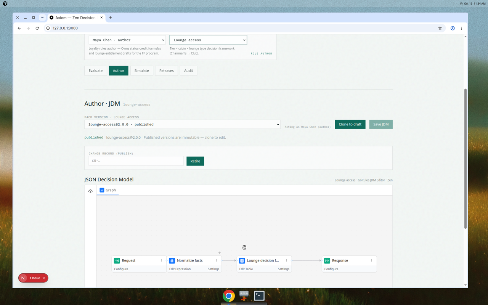
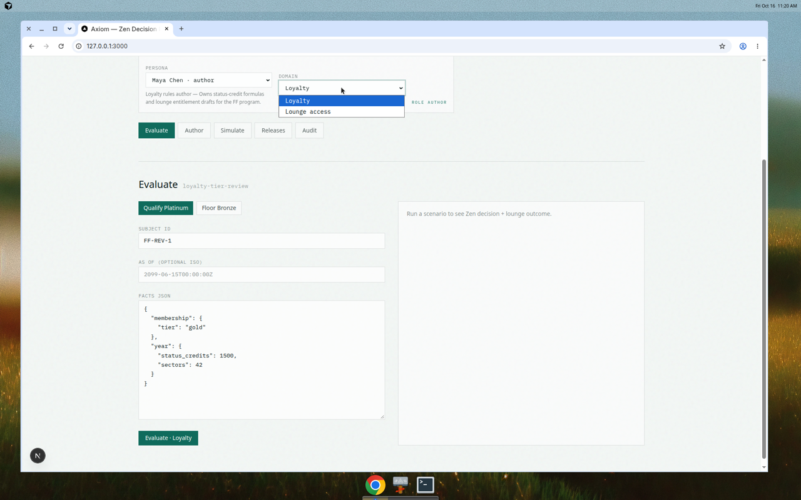
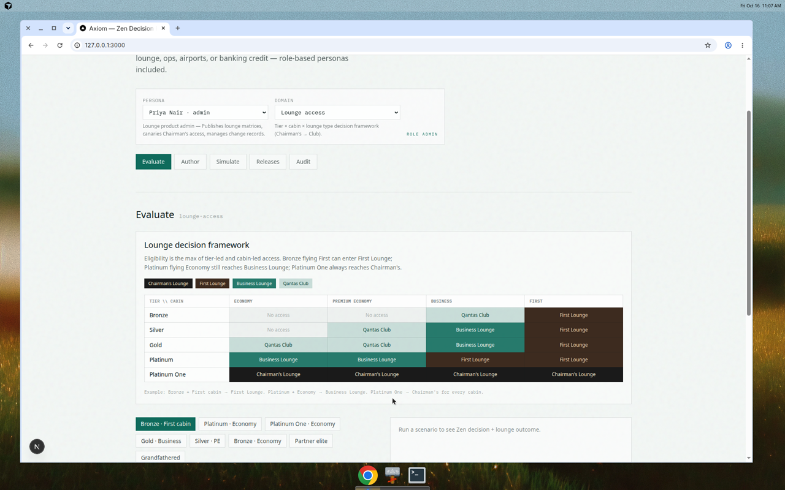
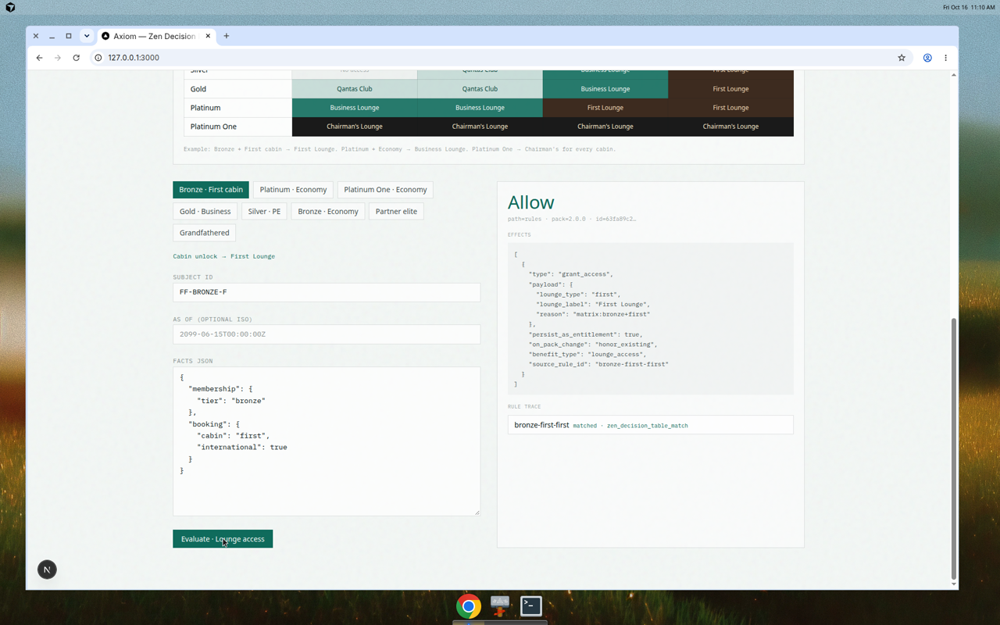
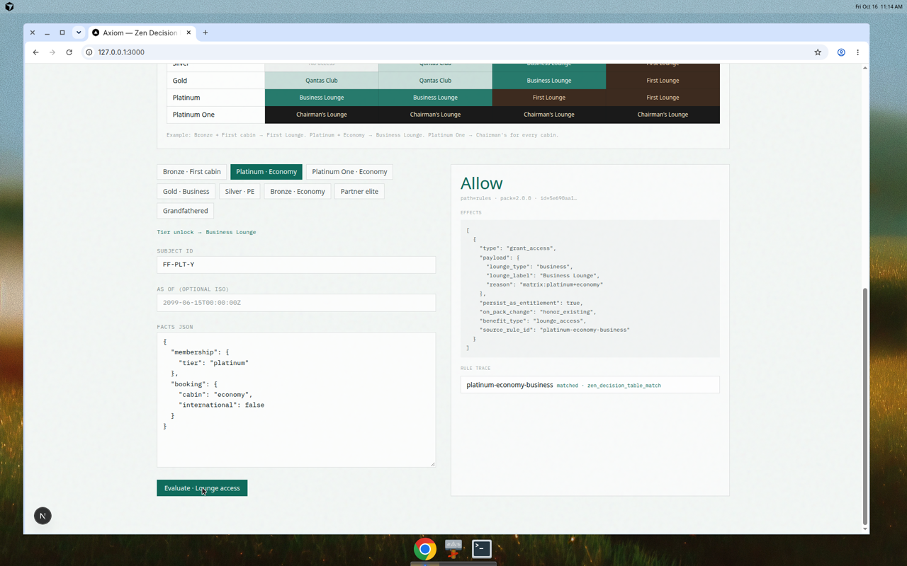
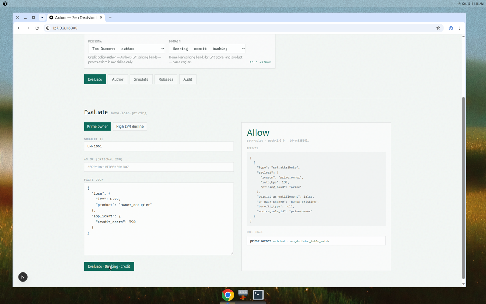
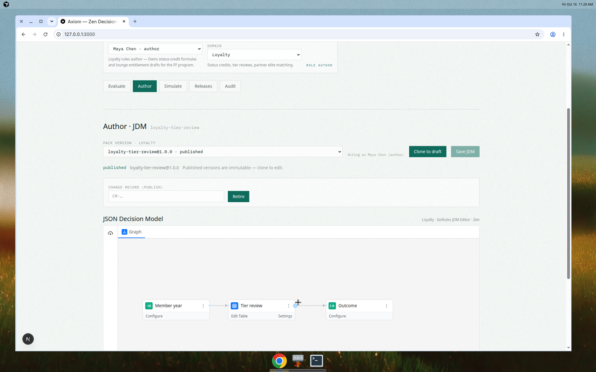
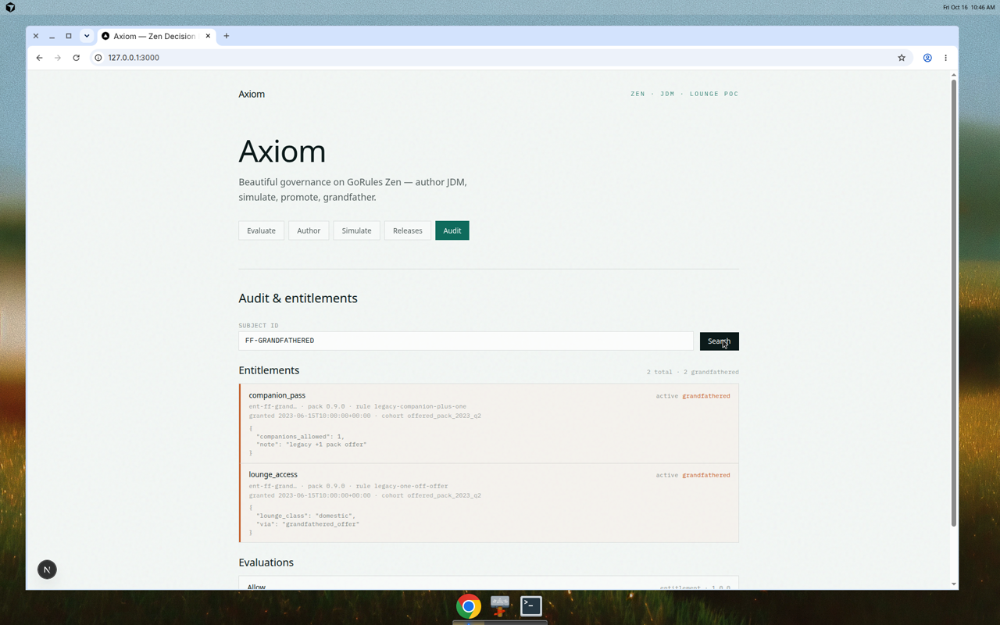

# Axiom

**Beautiful governance on [GoRules Zen](https://docs.gorules.io/).**

Axiom is a domain-agnostic decision platform. Business users author versioned **JSON Decision Models (JDM)** in a visual graph editor. Zen evaluates them deterministically. Axiom wraps the engine with what product teams actually need: personas and roles, multi-domain packs, simulation, change records, canary releases, grandfathered entitlements, and searchable audit.

We do **not** invent another rules interpreter. We productize an open-source one.

---

## Product at a glance

| Design time | Runtime |
|-------------|---------|
| Visual JDM graphs + decision tables | Facts in → decision + effects + full trace |
| Draft → review → approve → publish | Entitlement ledger (grandfathering) |
| Simulate & diff pack versions | Virtual canary by subject hash |
| Change-record gate to production | Append-only audit & compliance export |

**Same platform, many industries.** Airline lounge access today; home-loan pricing tomorrow — swap the domain and the graph, not the engine.

<p align="center">
  
</p>
<p align="center"><em>Author · Graph — lounge access decision model (Request → Normalize → Decision table → Response)</em></p>

---

## Tour the product

### 1. Personas & domains

Switch who you are and what you own. Authors only see domains they’re allowed to touch; approvers and admins promote; viewers audit.

<p align="center">
  
</p>

| Persona | Role | Domains |
|---------|------|---------|
| Maya Chen | Author | Loyalty, Lounge |
| James Okonkwo | Approver | Airline ops, Airports |
| Priya Nair | Admin | Lounge, Loyalty, Airports |
| Tom Barrett / Sofia Alvarez | Author / Approver | Banking · credit |
| Alex Kim | Viewer | All (read-only) |

Seeded domains: **Loyalty · Lounge access · Airline operations · Airports · Banking · credit**.

---

### 2. Decision framework (business view)

For lounge access, eligibility is a **tier × cabin** matrix across four lounge types: Chairman’s, First, Business, Qantas Club. Cabin can unlock above tier (Bronze flying First → First Lounge). Tier can unlock above cabin (Platinum flying Economy → Business Lounge).

<p align="center">
  
</p>

| Tier \\ Cabin | Economy | Premium Economy | Business | First |
|---------------|---------|-----------------|----------|-------|
| Bronze | — | — | Qantas Club | **First** |
| Silver | — | Club | Business | First |
| Gold | Club | Club | Business | First |
| Platinum | **Business** | Business | First | First |
| Platinum One | **Chairman's** | Chairman's | Chairman's | Chairman's |

---

### 3. Evaluate with full traces

Pick a scenario, run Zen, see decision + lounge outcome + matched rule rows.

<p align="center">
  
</p>
<p align="center"><em>Bronze · First cabin → Allow · First Lounge</em></p>

<p align="center">
  
</p>
<p align="center"><em>Platinum · Economy → Allow · Business Lounge</em></p>

Banking uses the same Evaluate UX — different graph, same runtime:

<p align="center">
  
</p>

---

### 4. Author · JDM graphs & tables

Open **Author · Graph** for the GoRules editor. Drag nodes, connect edges, open a decision-table node for the spreadsheet.

<p align="center">
  
</p>
<p align="center"><em>Lounge decision table — tier, cabin, partner elite → lounge type</em></p>

<p align="center">
  
</p>
<p align="center"><em>Banking · credit — Application → Home loan rate band → Offer</em></p>

<p align="center">
  
</p>
<p align="center"><em>Loyalty — Member year → Tier review → Outcome</em></p>

Published packs are **immutable**. Clone to draft → edit → submit for review → approve → publish with a change record.

---

### 5. Grandfathering & audit

Durable grants live in an entitlement ledger. Retired rule text is never kept alive for special subjects — the ledger is.

<p align="center">
  
</p>

---

## Architecture

```
┌─────────────────────────────────────────────────────────────┐
│  Axiom UI (Next.js)                                         │
│  Personas · Domains · Evaluate · Author (JDM Editor) ·      │
│  Simulate · Releases · Audit                                │
└───────────────────────────┬─────────────────────────────────┘
                            │  /api → FastAPI
┌───────────────────────────▼─────────────────────────────────┐
│  Platform API                                               │
│  Lifecycle · change records · canary · entitlements · audit │
└───────────────────────────┬─────────────────────────────────┘
                            │
┌───────────────────────────▼─────────────────────────────────┐
│  rules_engine adapter                                       │
│  Inject as_of · call Zen · map matches → effects ·          │
│  honor entitlements · deny-wins · explain · testgen         │
└───────────────────────────┬─────────────────────────────────┘
                            │
┌───────────────────────────▼─────────────────────────────────┐
│  GoRules Zen  ←  JSON Decision Model (nodes + edges)        │
└─────────────────────────────────────────────────────────────┘
```

### Three orthogonal state axes

1. **Lifecycle** (platform) — `draft → in_review → approved → published → retired`
2. **Temporal** (JDM) — `as_of` in context; date cells like `>= date('2099-01-01')`
3. **Subject-bound entitlements** (platform) — grandfathering via ledger, not zombie rules

### Pack envelope

Zen only needs `nodes` and `edges`. Axiom stores governance beside them:

```json
{
  "domain": "lounge",
  "pack_id": "lounge-access",
  "version": "2.0.0",
  "lifecycle": "published",
  "nodes": [ /* JDM */ ],
  "edges": [ /* JDM */ ]
}
```

### Monorepo

```
apps/
  web/                 Next.js 15 — Axiom UI + @gorules/jdm-editor
  api/                 FastAPI — design-time + runtime APIs
packages/
  rules_engine/        Zen adapter (evaluate / explain / testgen)
  rules_schema/        Pack JSON Schema
docs/
  PRODUCT.md           Product vision
  ARCHITECTURE.md      Deep architecture
  assets/              Screenshots for this README
```

Deeper reading: [Product vision](docs/PRODUCT.md) · [Architecture](docs/ARCHITECTURE.md)

---

## Developer how-to

### Prerequisites

- Node.js **20+** and [pnpm](https://pnpm.io/) 9+
- Python **3.11+**

### Install

```bash
make install-py    # venv + rules_engine + API + zen-engine
make install-web   # pnpm deps (Next + JDM editor)
```

### Run

```bash
make api           # http://127.0.0.1:8000  — OpenAPI at /docs
make web           # http://127.0.0.1:3000  — Axiom UI
```

Manual equivalent:

```bash
python3 -m venv .venv && source .venv/bin/activate
pip install -e packages/rules_engine -e apps/api
PYTHONPATH=packages/rules_engine/src:apps/api/src \
  uvicorn rules_api.main:app --reload \
    --reload-dir apps/api --reload-dir packages/rules_engine \
    --host 127.0.0.1 --port 8000

pnpm install && pnpm dev:web
```

### First five minutes in the UI

1. Open [http://127.0.0.1:3000](http://127.0.0.1:3000)
2. Pick persona **Priya Nair** · domain **Lounge access**
3. **Evaluate** — try *Bronze · First cabin* and *Platinum · Economy*
4. **Author · Graph** — open the lounge graph; click **Edit Table** on the decision-table node
5. Switch persona to **Tom Barrett** · domain **Banking · credit** — same product, different graph

### Tests

```bash
make test
```

### Useful API calls

```bash
# Catalog (domains, personas, lounge matrix)
curl -s localhost:8000/v1/catalog | jq .

# Explain a gold member in economy (defaults cabin via normalize)
curl -s localhost:8000/v1/explain -H 'content-type: application/json' \
  -d '{"subject_id":"FF-1","domain":"lounge","pack_id":"lounge-access",
       "facts":{"membership":{"tier":"gold"},"booking":{"cabin":"economy"}}}' | jq .

# Bronze flying First → First Lounge
curl -s localhost:8000/v1/evaluate -H 'content-type: application/json' \
  -d '{"subject_id":"FF-BRONZE-F","domain":"lounge","pack_id":"lounge-access",
       "facts":{"membership":{"tier":"bronze"},"booking":{"cabin":"first"}}}' | jq '.decision,.effects'

# Banking prime band
curl -s localhost:8000/v1/evaluate -H 'content-type: application/json' \
  -d '{"subject_id":"LN-1","domain":"banking_credit","pack_id":"home-loan-pricing",
       "facts":{"loan":{"lvr":0.7,"product":"owner_occupier"},
                "applicant":{"credit_score":790}}}' | jq .

# Compliance export for a grandfathered subject
curl -s 'localhost:8000/v1/compliance/export?subject_id=FF-GRANDFATHERED&domain=lounge' | jq .
```

### RBAC stub

Optional header `X-Role: viewer | author | approver | admin`.

| Action | Minimum role |
|--------|----------------|
| Evaluate / simulate / audit | any (or unrestricted if header absent) |
| Draft create / update | author+ |
| Approve / publish / promote | approver / admin |
| Publish & production promote | also requires `change_record_id` |

In the UI, the selected **persona** sets `X-Role` and filters domains.

### Database

SQLite by default (`apps/api/data/rules.db`). Optional `DATABASE_URL`:

| Value | Behaviour |
|-------|-----------|
| unset / `sqlite:///…` | Local SQLite |
| `postgres://…` | Planned — PoC warns and stays on SQLite |

---

## API surface (summary)

### Runtime

| Method | Path | Purpose |
|--------|------|---------|
| `POST` | `/v1/evaluate` | Decision + effects + Zen/platform trace |
| `POST` | `/v1/explain` | Human-readable reasons |
| `POST` | `/v1/simulate` | Fixture batch; optional version diff |
| `POST` | `/v1/testgen` | Permutation cases from table inputs |
| `GET` | `/v1/entitlements` | Subject ledger (`grandfathered` filter) |
| `GET` | `/v1/audit` · `/v1/audit/{id}` | Search / fetch |
| `GET` | `/v1/compliance/export` | Audit + entitlements dump |

### Design-time

| Method | Path | Purpose |
|--------|------|---------|
| `GET` | `/v1/catalog` | Domains, personas, frameworks |
| `GET/POST/PUT` | `/v1/packs/...` | List / draft / update JDM packs |
| `POST` | `.../transition` | Lifecycle transitions |
| `POST` | `.../promote` | Cutover / canary release pointer |
| `GET/PUT` | `/v1/releases/...` | Environment release config |

Full OpenAPI: [http://127.0.0.1:8000/docs](http://127.0.0.1:8000/docs) when the API is running.

---

## Why Zen + Axiom

| Build ourselves | Adopt Zen + build Axiom |
|-----------------|-------------------------|
| Condition IR, tables, expressions, traces | Already solved in GoRules Zen |
| Visual authoring | `@gorules/jdm-editor` |
| Governance, entitlements, canary, audit | **This product** |

Axiom’s bet: the engine is commodity; **trustworthy change** is the product.

---

## License & status

PoC for exploring multi-domain decision governance. Not production-hardened (SQLite, stub RBAC, seeded personas). Contributions and forks welcome as experiments.

---

<p align="center">
  <strong>Axiom</strong> — Decisions you can explain. Rules you can trust.<br/>
  <sub>Powered by GoRules Zen · JSON Decision Model</sub>
</p>
