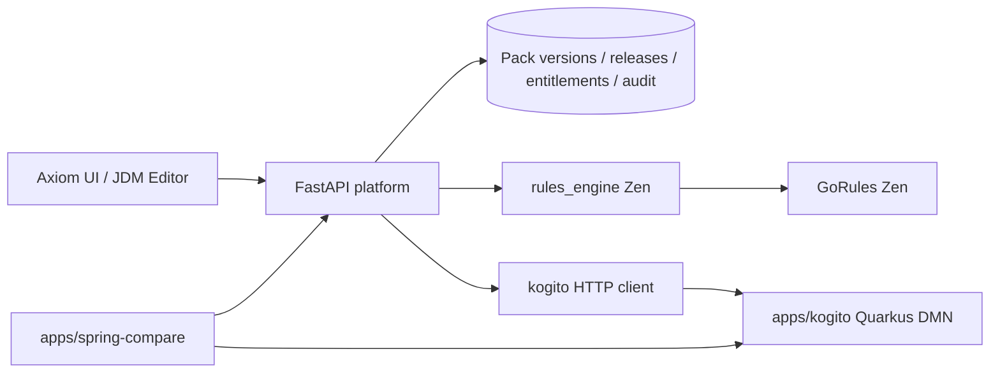

# Architecture

## Boundaries

| Layer | Responsibility |
|-------|----------------|
| `apps/web` | Authoring (GoRules JDM Editor), simulation, releases, audit UX — never embeds production eval logic |
| `apps/api` | Auth hooks, persistence, promotion, entitlement commits, change-record gates |
| `packages/rules_engine` | **GoRules Zen adapter**: run JDM, map outputs → effects, honor entitlements, deny-wins, explain, testgen |
| `apps/kogito` | **Kogito** (parallel): Quarkus + Drools DMN (`LoungeAccess.dmn`); REST at `:8081/LoungeAccess` |
| `apps/spring-compare` | **Spring Boot bake-off**: calls Zen then Kogito sequentially; latency, decision diff, hot-reload probes |
| `packages/rules_schema` | Shared JSON Schema for pack envelopes (`domain`/`lifecycle` + JDM `nodes`/`edges`) |

Authoring stays on the shared JDM UI. Runtime evaluation is selectable via `engine: zen | kogito` (UI toggle / request body). Zen evaluates the stored JDM; Kogito evaluates the seeded DMN model (facts mapped by the API adapter).



### Spring compare harness (`apps/spring-compare`)

Port **8082**. Orchestrates existing runtimes (does not embed engines):

1. `POST /v1/compare` — Zen via platform, then Kogito via platform (or `mode=direct-kogito` for Quarkus HTTP)
2. `POST /v1/compare/benchmark` — sequential iterations with p50/p95 wall timings
3. `GET /v1/compare/notes` — ease of implementation / execution speed / hot reload notes
4. `POST /v1/compare/hot-reload/probe` — before/after stamp when editing JDM packs or `LoungeAccess.dmn`

See `apps/spring-compare/README.md`.

## Rule state — three axes

### 1. Lifecycle (governance) — platform

On **RulePackVersion** / **Release**: `draft` → `in_review` → `approved` → `published` → `retired`.

Published versions are **immutable**. Edits create a new version.

Transition to `published` (and production promote) requires a `change_record_id`.

### 2. Temporal window — modeled in JDM

Pass `as_of` into the Zen context as a Unix timestamp. Decision-table (or expression) cells compare against `date('…')` unary expressions, e.g. `>= date('2099-01-01') and < date('2100-01-01')`.

### 3. Entitlement ledger (grandfathering) — platform

Do **not** keep retired rule text alive for special subjects.

When a mapped effect has `persist_as_entitlement: true`, the API appends an **Entitlement** row. Later evaluations honor active entitlements before (or alongside) the current JDM result.

Default promote policy: **cutover** for new subjects; **honor existing entitlements** for holders.

## Pack payload (JDM envelope)

```json
{
  "domain": "lounge",
  "pack_id": "lounge-access",
  "version": "1.0.0",
  "lifecycle": "published",
  "nodes": [ /* JDM */ ],
  "edges": [ /* JDM */ ]
}
```

Only `nodes` and `edges` are passed to Zen. Platform fields travel with the stored version for governance.

### Effect mapping convention

Lounge (and similar) decision tables use `hitPolicy: collect` with `outputPath: "matches"`. Each matched row may include:

| Field | Role |
|-------|------|
| `decision` / `effect_type` | `allow` \| `deny` \| `grant_access` \| … |
| `benefit_type` | Ledger benefit when persisting |
| `persist_as_entitlement` | Commit to entitlement ledger |
| `rule_id` | Trace / audit identity |
| `lounge_class`, `reason`, `companions_allowed`, `via` | Effect payload |

## Evaluate order

1. Resolve release for environment; if `canary_percent < 100` and `canary_version` is set, stable-hash `subject_id` into a 0–99 bucket and pick canary vs production version
2. Load active entitlements for `subject_id` as of `as_of` (scoped by `tenant_id`)
3. If an entitlement covers the decision → trace `entitlement_honored`
4. Evaluate pack JDM with Zen (`trace: true`); inject `as_of` timestamp into context
5. Map collected matches → effects; **deny-wins** with entitlement effects
6. If grant effects fire and `commit_entitlements` → append ledger rows

## Conflict policy (v1)

Collect matching effects; **deny-wins** if any deny effect is present.

## Stores

Persistence is behind `RulesStore` (`apps/api/src/rules_api/store.py`). Default implementation: **SQLite** (`SqliteRulesStore`).

| Store | Mutability | Contents |
|-------|------------|----------|
| Pack definitions | Append versions | JDM envelope (nodes/edges + lifecycle) |
| Release pointers | Updated on promote | Which pack serves env / canary % / canary_version |
| Entitlement ledger | Append + status transitions | Subject-bound grants |
| Audit | Append-only | Every evaluation + path taken |

### Multi-tenancy (PoC stub)

All meaningful tables carry `tenant_id` (default `default`). Evaluate, entitlements, audit, packs, and releases accept `tenant_id` on the request body or query string.

### `DATABASE_URL`

| Value | Behaviour |
|-------|-----------|
| unset | SQLite at `apps/api/data/rules.db` |
| `sqlite:///…` | That SQLite file |
| `postgres://` / `postgresql://` | **Planned** — PoC emits a warning and keeps SQLite |

## RBAC stub

Optional header `X-Role: viewer | author | approver | admin`.

- Absent → unrestricted (local PoC)
- Promote / lifecycle transition / release PUT → `approver` or `admin`
- Draft pack create/update → `author+`

## API surface (Phases 0–3)

### Runtime

- `POST /v1/evaluate`
- `POST /v1/explain`
- `POST /v1/simulate`
- `POST /v1/testgen` — max_cases default 50, hard max 500
- `GET /v1/entitlements?subject_id=` (+ optional `grandfathered`)
- `GET /v1/audit/{evaluation_id}`
- `GET /v1/audit?subject_id=`
- `GET /v1/compliance/export?subject_id=&domain=`

### Design-time

- `GET /v1/packs/{domain}`
- `GET /v1/packs/{domain}/{pack_id}/versions/{version}`
- `POST /v1/packs/{domain}/{pack_id}/versions`
- `PUT /v1/packs/{domain}/{pack_id}/versions/{version}` (draft only)
- `POST /v1/packs/{domain}/{pack_id}/versions/{version}/transition`
- `POST /v1/packs/{domain}/{pack_id}/promote`
- `GET` / `PUT /v1/releases/{domain}/{pack_id}`
